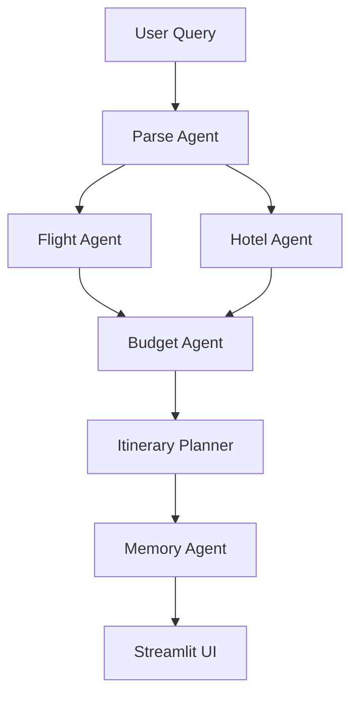

# ✈️ Autonomous Multi-Agent AI Travel Booking System

An intelligent **AI-powered travel planning system** built with LangGraph, Groq, Tavily, and PostgreSQL. It coordinates specialized AI agents to research flights, calculate travel budgets, and generate personalized multi-day itineraries.

## ✨ Key Features

- **Multi-Agent Orchestration:** Parallel flight research using LangGraph.
- **AI Itinerary Planning:** Personalized multi-day travel plans.
- **Deterministic Budget Engine:** Python-based calculations with multi-currency support.
- **Smart Transit Routing:** Specialized routing for 44+ configured hill stations.
- **Long-Term Memory:** PostgreSQL-powered user preference storage.
- **Robust NLP:** Reverse routes, multi-city trips, and group travel.
- **Responsive UI:** Modern dark-themed Streamlit interface.

## 🏛️ System Architecture



## 🛠️ Tech Stack

| Technology | Purpose |
|---|---|
| Python | Core development |
| LangGraph | Agent orchestration |
| Groq / Qwen | LLM inference |
| Tavily | Web research |
| AviationStack | Flight data |
| PostgreSQL | Persistent memory |
| Pydantic | Data validation |
| Streamlit | Frontend |

## 🧪 Benchmark Results

**120/120 test cases passed (100%)** across seven testing categories.

| Test Category | Cases |
|---|---:|
| Reverse Route Parsing | 20 |
| Multi-City Parsing | 15 |
| Group Extraction | 25 |
| Room Allocation | 15 |
| Currency Extraction | 15 |
| Hill-Station Routing | 20 |
| Flight Queries | 10 |
| **Total** | **120/120** |

## 📂 Project Structure

```text
AI-Travel-Booking-System/
├── app.py
├── main.py
├── requirements.txt
├── styles.css
├── .gitignore
├── tools/
│   ├── __init__.py
│   ├── budget_tool.py
│   ├── flight_tool.py
│   └── tavily_tool.py
└── README.md
```

## 🚀 Quick Start

### 1. Clone Repository

```bash
git clone https://github.com/rohitrajntpc-hub/AI-Travel-Booking-System.git
cd AI-Travel-Booking-System
```

### 2. Create Virtual Environment

```bash
python -m venv langgraph_env
```

### 3. Activate Environment (Windows)

```powershell
.\langgraph_env\Scripts\Activate.ps1
```

### 4. Install Dependencies

```bash
pip install -r requirements.txt
```

### 5. Configure Environment Variables

Create a `.env` file:

```env
GROQ_API_KEY=your_groq_api_key
GROQ_MODEL=your_supported_model_id
TAVILY_API_KEY=your_tavily_api_key
AVIATIONSTACK_API_KEY=your_aviationstack_key
DATABASE_URL=your_postgresql_url
```

### 6. Run Application

```bash
streamlit run app.py
```

Open: http://localhost:8501

## ⚠️ Important Notes

- Flight results are research suggestions, not confirmed bookings.
- Actual ticket purchases are not supported.
- Prices and availability may change.
- PostgreSQL is optional but required for persistent memory.

## 👨‍💻 Author

**Rohit Raj**

- GitHub: [@rohitrajntpc-hub](https://github.com/rohitrajntpc-hub)
- LinkedIn: [https://www.linkedin.com/in/rohit-raj-227690293/]


⭐ If you find this project useful, consider giving it a star!
